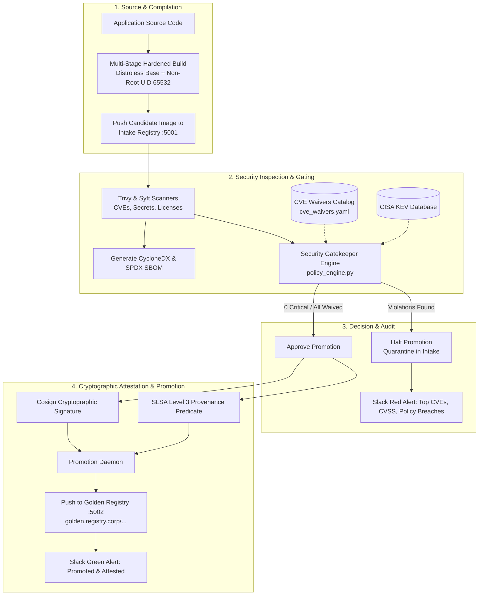
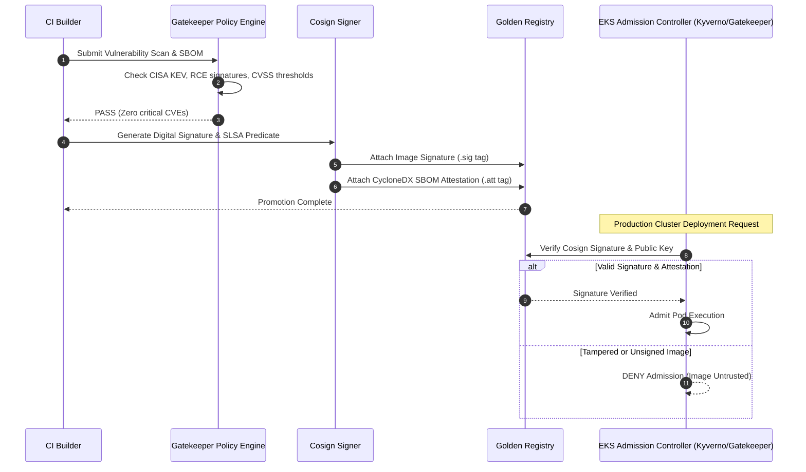

# Enterprise Container Supply Chain Security Pipeline

[](https://www.docker.com/)
[](https://sigstore.dev/)
[](#compliance-standards)
[](LICENSE)
[](https://github.com/Bhomesh/enterprise-container-supply-chain/actions)

An automated, zero-trust container image hydration, vulnerability gating, cryptographic attestation, and registry promotion pipeline engineered for regulated banking environments.

---

## 🛡️ Pipeline Architecture

Traditional CI/CD pipelines push vulnerable container images directly into shared production registries. This architecture implements a **Quarantine Intake vs. Golden Registry** model guarded by an automated Policy Engine, Cosign signatures, CycloneDX SBOM generation, and SLSA Level 3 provenance verification.



---

## 🏛 SLSA Level 3 Attestation & In-Toto Architecture

Every image promoted to the Golden Registry is cryptographically immutable and verified using Sigstore Cosign:



---

## 📁 Repository Structure

```
.
├── docker/
│   ├── Dockerfile.hardened         # Production multi-stage distroless container definition
│   ├── Dockerfile.vulnerable_sample # Seeded container for negative security testing
│   ├── docker-compose.yml          # Local Intake (:5001) & Golden (:5002) registries
│   └── app/
│       └── main.go                 # Enterprise Golang microservice source
├── policies/
│   ├── security_gate_rules.yaml    # Strict CVE thresholds & CVSS rules
│   ├── cve_waivers.yaml            # Time-bounded approved exceptions & business justifications
│   └── license_policy.yaml         # Open-source license whitelist & copyleft blacklist
├── src/
│   ├── gatekeeper.py               # Security Gatekeeper CLI runner
│   ├── policy_engine.py            # Vulnerability parser & compliance evaluator
│   ├── sbom_generator.py           # CycloneDX & SPDX SBOM generator
│   ├── cosign_signer.py            # Cryptographic signing & SLSA provenance attestation
│   ├── promotion_daemon.py         # Automated promotion orchestrator
│   └── slack_notifier.py           # Block Kit webhook notification generator
├── tests/
│   ├── test_policy_engine.py       # Unit tests for threshold and waiver evaluation
│   ├── test_sbom.py                # SBOM schema & component validation tests
│   ├── test_cosign.py              # Cryptographic signature & attestation tests
│   ├── test_promotion.py           # Promotion daemon & Slack card unit tests
│   └── fixtures/                   # Realistic test reports (clean, critical, waived)
├── .github/workflows/
│   ├── container-supply-chain.yml  # Main CI/CD pipeline
│   └── nightly-cve-audit.yml       # Daily zero-day rediscovery audit
├── Makefile                        # Common developer workflows
├── requirements.txt                # Python dependencies
├── pyproject.toml                  # Package configuration
└── LICENSE                         # Apache 2.0
```

---

## 🔒 Compliance & Standards Alignment

| Standard | Requirement | Implementation in this Pipeline |
|---|---|---|
| **Executive Order 14028** | Enhancing Software Supply Chain Security | Automated CycloneDX SBOM generation and retention for all releases. |
| **NIST SP 800-190** | Application Container Security Guide | Hardened distroless runtime, immutable filesystems, non-root execution (UID 65532). |
| **NIST SP 800-218 (SSDF)** | Secure Software Development Framework | Cryptographic code and artifact signing via Cosign; SLSA Level 3 provenance. |
| **CISA KEV** | Known Exploited Vulnerabilities Catalog | Immediate hard-rejection if any dependency matches active exploits in the wild. |
| **PCI-DSS 4.0 Req 6.2** | Software Vulnerability Management | Time-bounded CVE waiver lifecycle with mandatory approvers and expiry audits. |

---

## 🚀 Quickstart & Testing

### 1. Execute Unit Test Suite
```bash
make test
```
Output:
```text
Ran 12 tests in 0.062s
OK
```

### 2. Test Security Gatekeeper on Fixtures

**A. Test Clean Image (Passes Gate):**
```bash
python3 src/gatekeeper.py \
  --report tests/fixtures/trivy_sample_clean.json \
  --policy policies/security_gate_rules.yaml \
  --waivers policies/cve_waivers.yaml
```
Output:
```text
============================================================
       CONTAINER SECURITY GATING VERDICT
============================================================
Status:   [APPROVED]
Critical: 0
High:     0
Medium:   0
Low:      0
Waived:   0 (None)
============================================================
```

**B. Test Critical Image with CISA KEV (Fails Gate with Exit Code 1):**
```bash
python3 src/gatekeeper.py \
  --report tests/fixtures/trivy_sample_critical.json \
  --policy policies/security_gate_rules.yaml \
  --waivers policies/cve_waivers.yaml || echo "Gate correctly blocked promotion!"
```
Output:
```text
============================================================
       CONTAINER SECURITY GATING VERDICT
============================================================
Status:   [REJECTED]
Critical: 2
High:     0
Medium:   0
Low:      0
Waived:   0 (None)

Policy Violations:
  ❌ RCE Violation: CVE-2022-2068 in openssl allows Remote Code Execution
  ❌ CISA KEV Exploit Violation: CVE-2021-44228 (log4j-core) is actively exploited in the wild
  ❌ Threshold Violation: Found 2 Critical CVEs (Max allowed: 0)
============================================================
```

**C. Test Active Waiver Exception (Passes via Authorized Waiver):**
```bash
python3 src/gatekeeper.py \
  --report tests/fixtures/trivy_sample_waived.json \
  --policy policies/security_gate_rules.yaml \
  --waivers policies/cve_waivers.yaml
```
Output:
```text
[INFO] CVE CVE-2023-44487 is waived: HTTP/2 Rapid Reset mitigation deployed at cloud WAF / ALB layer.
Status: [APPROVED]
Waived: 1 (CVE-2023-44487)
```

---

## 📄 License
This project is licensed under the Apache 2.0 License - see the [LICENSE](LICENSE) file for details.
